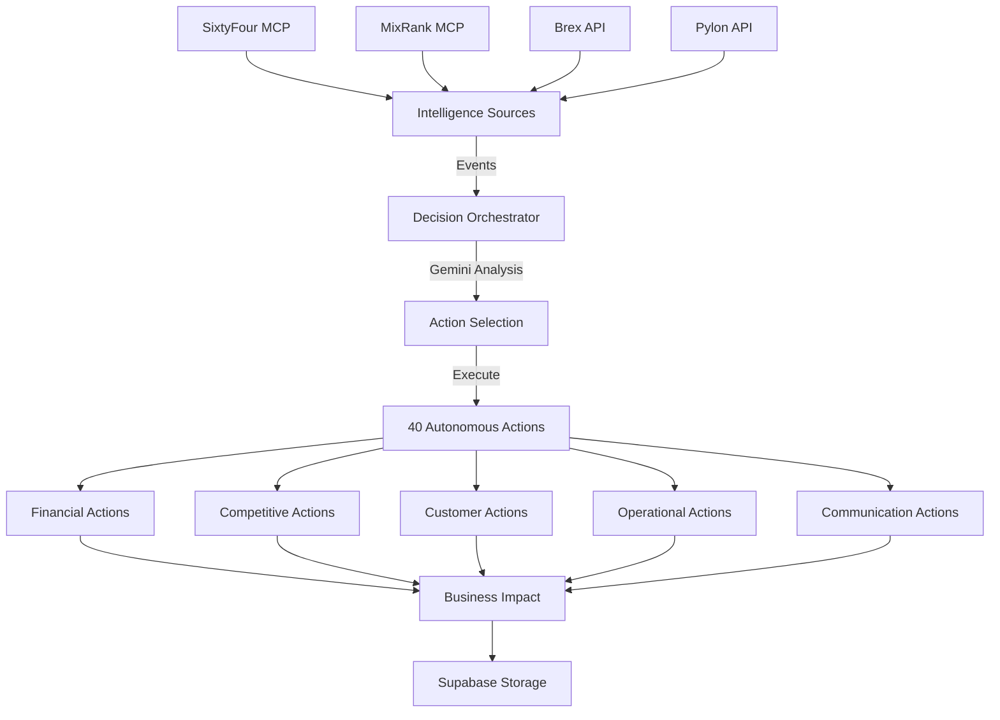

# Pensieve

An autonomous business intelligence agent built at the Brex Agent Jam hackathon (3rd place). Pensieve monitors company data sources, makes autonomous business decisions, and executes actions like vendor negotiation emails without human approval.

## Hackathon Result

**3rd Place** at Brex Agent Jam hackathon  
Built by Amy Wang

## What It Does

Pensieve is an autonomous business intelligence agent that:

1. **Monitors data sources** through MCP servers and API clients (SixtyFour, MixRank, Brex, Pylon)
2. **Uses Gemini** as the decision orchestrator to analyze events and select actions
3. **Executes autonomous actions** across financial, competitive, customer, operational, and communication domains
4. **Stores intelligence** in Supabase for historical analysis
5. **Takes real actions** like sending vendor negotiation emails through Gmail

The agent is designed to process intelligence events (competitor distress, customer churn risk, financial crisis, etc.) and autonomously execute business actions without human approval.

## How It Works



**Key Components:**

- `autonomous_agent.py`: Core agent with 40 action implementations
- `vendor_negotiation_system.py`: Autonomous vendor negotiation via email
- `gmail_send.py`: Gmail API integration for outbound communication
- `intelligence-engine/decision_orchestrator.py`: Gemini-powered decision logic
- `mcp-servers/`: Data connectors for SixtyFour, MixRank, Brex
- `api_server.py`: FastAPI endpoints for triggering agent

## Tech Stack

- **AI/LLM**: Google Gemini (gemini-2.0-flash) for decision orchestration
- **Data Sources**: SixtyFour API (company intelligence), MixRank API (technology analysis), Brex API (financial data, mocked), Pylon API (customer data, not available)
- **Database**: Supabase (PostgreSQL) for storing decisions and events
- **Backend**: FastAPI, Python 3.11+
- **Email**: Gmail API with OAuth2
- **Task Processing**: Async Python with httpx

## Setup

### Prerequisites

- Python 3.11+
- Gmail account for email automation
- API keys for SixtyFour, MixRank (Brex and Pylon optional)
- Supabase account

### Installation

1. Clone the repository
2. Install dependencies:

```bash
pip install -r requirements.txt
```

3. Copy `.env.example` to `.env` and add your API keys:

```bash
cp .env.example .env
```

4. Configure environment variables (see `.env.example` for required keys):
   - `GEMINI_API_KEY`: Google Gemini API key
   - `SIXTYFOUR_API_KEY`: SixtyFour API key
   - `MIXRANK_API_KEY`: MixRank API key
   - `SUPABASE_URL`: Supabase project URL
   - `SUPABASE_KEY`: Supabase anon key
   - `BREX_API_KEY`: (optional, currently mocked)
   - `PYLON_API_KEY`: (optional, not available in current implementation)

5. Set up Supabase tables:

```bash
# Run the SQL schema from setup_supabase_schema.md in your Supabase SQL editor
```

6. (Optional) Configure Gmail API for vendor negotiation emails:
   - Download `credentials.json` from Google Cloud Console
   - Follow setup in `docs/gmail_sender_guide.md`

### Running the Backend

**Start the main autonomous agent:**

```bash
python main.py
```

**Start the API server:**

```bash
python api_server.py
# or
uvicorn api_server:app --host 0.0.0.0 --port 8000
```

**Run the autonomous agent directly:**

```bash
python autonomous_agent.py
```

The API server exposes endpoints at `http://localhost:8000`:
- `/health`: Health check
- `/status`: Agent status and metrics
- `/actions`: List all available actions
- `/intelligence/event`: Process an intelligence event
- `/actions/execute`: Execute a specific action

## Repository Structure

```
pensieve/
├── autonomous_agent.py           # Core agent with 40 autonomous actions
├── vendor_negotiation_system.py  # Email-based vendor negotiation
├── gmail_send.py                 # Gmail API integration
├── api_server.py                 # FastAPI server
├── main.py                       # Main orchestrator entry point
├── config/
│   ├── settings.py              # Environment configuration
│   ├── supabase_client.py       # Database client
│   └── logging_config.py        # Logging setup
├── intelligence-engine/
│   ├── decision_orchestrator.py # Gemini-powered decision making
│   ├── autonomous_action_engine.py
│   ├── cache/                   # Intelligence caching
│   ├── storage/                 # Data persistence
│   └── tools/                   # Action implementations
├── mcp-servers/
│   ├── sixtyfour-mcp/          # SixtyFour company intelligence
│   ├── mixrank-mcp/            # MixRank technology intelligence
│   ├── brex-mcp/               # Brex financial data (mocked)
│   └── cfo-mcp/                # CFO decision tools
├── data-pipeline/
│   └── event_processor.py      # Real-time event processing
├── tests/                      # Test suite
└── docs/                       # Documentation
```

## What Works vs. What's Mocked

**Working implementations:**
- SixtyFour API integration for company intelligence
- MixRank API integration for technology analysis
- Gemini decision orchestration
- Supabase data storage
- Gmail API for autonomous vendor negotiation emails
- 40 autonomous action types (financial, competitive, customer, operational, communication)
- FastAPI backend with real endpoints
- Intelligent caching system
- Real-time event processing

**Mocked/Not Available:**
- Brex financial monitoring (API not available, uses mock data in `brex-mcp/mock_financial_data.py`)
- Pylon customer intelligence (API not available, removed from main.py)
- Some vendor email delivery uses IFTTT webhook demo mode instead of direct SMTP
- Business impact calculations are simulated (real actions would require integrated CRM/accounting systems)

## Limitations

- **Production readiness**: This is a hackathon proof-of-concept. It would need security hardening, approval workflows, and testing before production use.
- **API availability**: Brex and Pylon integrations are incomplete due to API access limitations during the hackathon.
- **Action execution**: Most actions generate recommendations and log to the database. The vendor negotiation email system demonstrates real autonomous action execution.
- **Decision validation**: The Gemini orchestrator makes autonomous decisions without human approval or validation loops.
- **Error handling**: Basic error handling exists but would need production-grade retry logic and failure recovery.
- **Monitoring**: Logging exists but lacks production monitoring, alerting, and observability.
- **Cost controls**: No spending limits or approval gates on autonomous actions.
- **Compliance**: No audit trails or compliance controls suitable for regulated environments.

## License

MIT

## Acknowledgments

Built for the Brex Agent Jam hackathon. Thanks to Brex for hosting and to the companies providing API access during the event.
